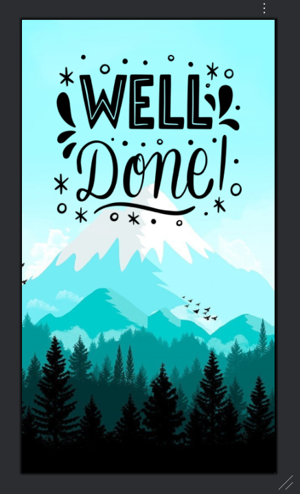
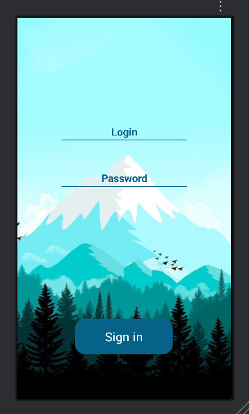
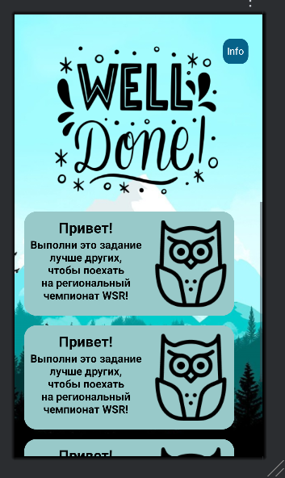
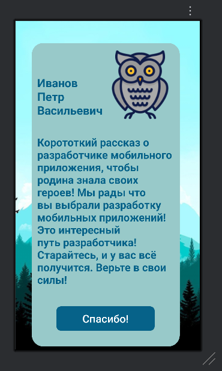

# Android Multi-Screen UI
Многостраничная верстка по макету из Figma. 

## Скриншоты

  
  
  
  

## Стек
- XML

## Что реализовано
- Верстка сложных экранов с использованием ConstraintLayout
- Создание карточек с изображениями и текстом
- Работа с кастомными фонами и стилями (colors.xml, styles.xml)
